<!-- Animated contribution graph: real data, rendered as an SVG by
     scripts/render_heatmap_svg.py and refreshed daily by
     .github/workflows/update-profile-art.yml -->

<h3><code>krupal@github ~ $ ./contributions.sh</code></h3>

 
 

<!-- ASCII portrait (left) + streak/numbers card (right). Both SVGs are
     840x880, so equal widths give equal heights.
     portrait: built by .github/workflows/make-portrait.yml from source-photo.*
     stats:    built by .github/workflows/update-profile-art.yml -->

<h3><code>krupal@github ~ $ whoami</code></h3>

<table>
<tr>
<td valign="top"></td>
<td valign="top"></td>
</tr>
</table>

 
 

<h3><code>krupal@github ~ $ ./links.sh</code></h3>

<b>Full-Stack Web Developer · Building an ERP Payroll System · AI-Assisted Builder</b>

 

